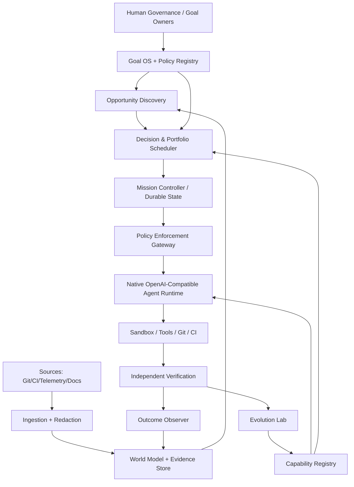

# 24 — Reference Architecture: control plane, data plane, trust plane

## 1. Kiến trúc logic — không ép microservices

**Control plane:** goals, policy, identities, portfolio, mission warrants. **Intelligence/data plane:** observations, claims, embeddings/index, evidence. **Execution plane:** model calls, sandboxes, tools, CI. **Evolution plane:** benchmarks, candidates, capability promotion. Các lớp có các đường tin cậy rõ.

## 2. V0 physical deployment

- **API + domain modules**: FastAPI hoặc backend framework đội quen, một service modular monolith.
- **PostgreSQL**: canonical state, outbox, decisions, job records, permissions metadata.
- **Object storage**: raw redacted events, diff, reports, snapshots, artifacts.
- **Worker(s)**: ingestion, opportunity analysis, mission execution, eval tasks; isolate resource pools.
- **Sandbox host/runner**: container runtime riêng mạng/identity; không đưa secrets chính vào containers.
- **Git/CI connectors**: short-lived auth, branch-only, webhook ingestion.
- **Model provider gateway**: OpenAI-compatible base URL/key/model, capability probing, request logging redacted.
- **Minimal portal**: Goal list, Opportunity queue, Mission ledger, Evidence viewer, Approvals, Provider health.

Docker Compose có thể đủ cho lab; production hoặc multi-tenant isolation cần nâng cấp theo threat model. Không tự động xây Kafka/K8s/graph database ngay.

## 3. Module boundaries

| Module | Owns | Emits | Depends on |
|---|---|---|---|
| Goal | goal charter/version | GoalActivated/Degraded | identity, metrics |
| World | claims + provenance | ClaimUpdated/Contradicted | ingestion |
| Opportunity | findings/candidates | OpportunityProposed | world, goals |
| Decision | selection/alternatives | DecisionCommitted | policy, portfolio |
| Mission | warrants/state/DAG | MissionStateChanged | decision, worker |
| Runtime | agent runs/tool traces | ToolCallProposed/Completed | provider, policy, sandbox |
| Verification | reports & oracle outcomes | VerificationRecorded | CI/artifacts |
| Evolution | capability candidates/evals | CapabilityPromoted | evidence, registry |

Modules gọi nhau bằng typed interfaces và events; tránh shared table writes cross-module dù cùng DB. Mọi giao dịch side effect dùng outbox.

## 4. Khả năng mở rộng theo áp lực thật

- World graph query chậm → specialized graph/search store.
- Mission long-horizon cần replay/compensation → workflow engine như Temporal [R5].
- Event volume cao → event streaming; vẫn dùng outbox/consumers idempotent.
- Nhiều tenant không tin cậy → isolated worker pools + microVM, tenancy-enforced DB.
- Model provider đa dạng → gateway/router riêng, profile testing.

Thiết kế đủ “seams” để thay nhưng không trả chi phí vận hành trước khi cần.

## 5. Bất biến kiến trúc xuyên lớp

- LLM không thể trực tiếp ghi Goal/Policy/Permissions.
- Không side effect vượt Tool Gateway.
- Mọi Mission có `goal_ref`, `decision_ref`, `warrant_ref`.
- Mọi kết luận “pass” có `oracle/evidence_ref`, không do executor tự phát.
- Outcome observer không sửa lịch sử mission; append một kết quả mới.
- Tất cả API queries và indices enforce tenant + asset scope.

## 6. Tỷ lệ nguồn lực đề xuất

Đầu tư nhiều hơn vào **evidence + world model + evaluation** so với “số nhân cách agent”. Không có chúng, nhà máy chạy nhanh nhưng không thể chứng minh đang tiến bộ. Nhóm nhỏ có thể kiêm nhiệm modules, nhưng trách nhiệm security/review phải tách khỏi executor khi cấp quyền quan trọng.
