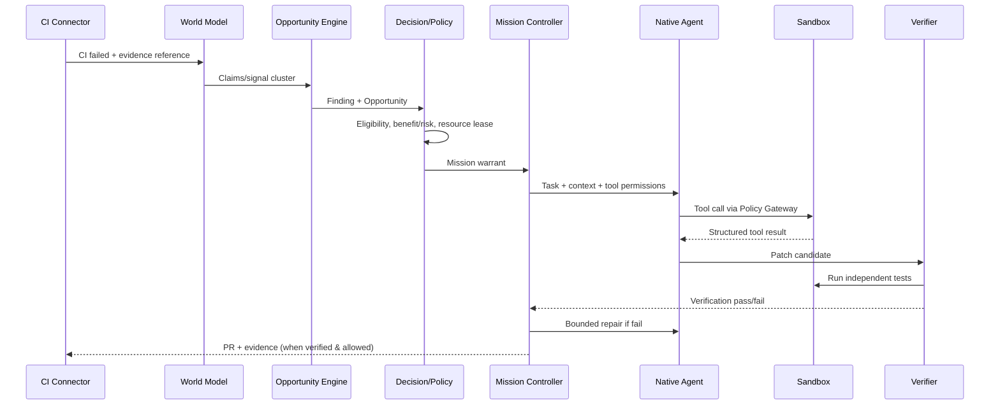

# 29 — MVP V0/V1: cấu hình cụ thể để xây vòng lặp A–B–C nhỏ

## 1. V0: Shadow Brain (không write side)

**Chức năng:** đọc 2–3 repos, CI status và test reports; tạo asset catalog, claim evidence, signal clusters, findings, opportunities, goal alignment; hiển thị decision recommendation + reason; human triage.

**Modules:** `goals`, `connectors`, `world`, `opportunity`, `evaluation`, `audit`, `api`, `ui`; một Postgres và object store. Chưa native coding executor, chưa production write.

**Acceptance:** ít nhất 30 observed events, 10 candidate opportunities có evidence, blind reviewer đánh giá; phân biệt false/true findings; dedup hoạt động; provider failure không phá pipeline.

## 2. V1: Bounded Mission Factory

Thêm `decision`, `missions`, `policy`, `provider`, `agent_runtime`, `tool_gateway`, `sandbox`, `verification`, `capability_candidates`.

**Single path ưu tiên:** CI regression được phát hiện → finding evidence → opportunity score → mission warrant (branch-only) → AI code analysis → patch → tests → bounded repair → PR → outcome pending → candidate lesson. Chưa deploy production.

### API/UI tối thiểu

- Goal detail: user tạo/activate Goal có measurements, budgets và asset scope.
- Opportunity inbox: reviewers xem evidence, approve/defer/reject/snooze.
- Mission detail: plan DAG, policy decisions, sandbox logs, branch artifacts, verification.
- Providers: endpoint connection test + tool-calling probe (không lộ key).
- Evolution Lab: manual run A/B capability eval.
- Ops: kill switch, budgets, source health, audit.

## 3. Công nghệ đề xuất, có thể thay

```text
Frontend              Next.js/React (hoặc framework quen)
Backend               Python FastAPI + Pydantic + SQLAlchemy/Alembic
Database              PostgreSQL
Artifact store         Local S3-compatible/MinIO or managed object storage
Background jobs        DB outbox + worker, durable state & retries
LLM transport          OpenAI-compatible Chat Completions adapter
Provider config        base_url, api_key secret ref, model, capabilities
Sandbox                isolated container runner with egress limits
Source connectors      GitHub/GitLab read initially; CI webhook
Observability          Structured logs + OpenTelemetry
Auth                   OIDC or existing internal SSO
Policy                 typed service rules; OPA later if needed
```

Đây là **[DESIGN]**, không phải “stack tốt nhất” phổ quát. Nếu team mạnh Node.js, có thể dùng NestJS; giao thức/hợp đồng quan trọng hơn ngôn ngữ.

## 4. V1 repository skeleton

```text
aeo/
  apps/
    api/
    web/
    worker/
  packages/
    domain-contracts/
    providers/openai-compatible/
    connectors/git/
    connectors/ci/
    world-model/
    opportunity-engine/
    decision-engine/
    missions/
    tool-gateway/
    sandbox-runner/
    verification/
    capabilities/
    eval-harness/
  infra/
    local/
    migrations/
    monitoring/
  examples/
    fixture-repos/
    goal-contracts/
    mission-contracts/
  docs/
    architecture/
    runbooks/
    threat-model/
```

Không cần đúng y hệt; các package chỉ là boundaries có thể cùng process.

## 5. End-to-end sequence



## 6. Đường nghiệm thu không giả

V0 có thể dùng repo synthetic và CI fixture; V1 phải có một **real OpenAI-compatible endpoint** hỗ trợ tool calling, một repo mẫu có lỗi thật, patch thật, sandbox tests thật, PR hoặc branch artifact thật. Nếu API key không có, mock chỉ chứng minh orchestration, phải báo `REAL_AGENT_UNVERIFIED`.

## 7. Những thứ cố tình chưa làm

- Không auto deploy production.
- Không multi-tenant commercial billing.
- Không knowledge graph khổng lồ.
- Không fine-tuning.
- Không bầy agent cố định.
- Không self-edit policy hoặc automated cross-customer learning.
- Không hứa “làm tất cả phần mềm” ở V1.

## 8. Observability để không bị “demo theater”

Every screenshot/metric from real DB state; audit ability to link goal→opportunity→mission→tools→tests→outcome; operator có thể freeze; dependency/version/time clear. Feature không được báo done nếu chỉ có frontend giả dữ liệu.
